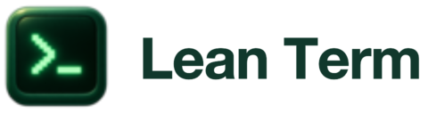

# Lean Term

<picture>
  <source media="(prefers-color-scheme: dark)" srcset="branding/approved/crt-family/lean-term/wordmark-on-dark@2x.png">
  
</picture>

[](https://github.com/mattivilola/lean-term/actions/workflows/ci.yml)

A small, native terminal for macOS. Built for responsive typing, a clean interface
and a little less distraction. Free and open source.

[Website](https://leanterm.com) · [Build](#build-and-run) · [Contributing](CONTRIBUTING.md) · [MIT license](LICENSE)

**0.4.0** · Apple silicon · macOS 26+.
[Releases and downloads](https://github.com/mattivilola/lean-term/releases).
You can also build from source without a signing account.

## What it does

- Runs your normal login shell, startup files and environment.
- Native macOS windows and tabs, with independent terminal sessions.
- Short folder labels, editable tab names, direct numbered switching and optional workspace reopening.
- Unicode text, terminal applications, selection, copy/paste and built-in Find.
- Bounded 10,000-line scrollback; clear screen and history without sending input to a program.
- System/Light/Dark appearance, Forest and Graphite palettes, font size/family,
  cursor shape and optional Option-as-Meta, in a compact visual settings window.
  SF Mono Regular 13 is the default; existing saved font choices are preserved.
- Optional compact CPU/memory sparklines for the app process, plus configurable
  close-on-shell-exit and quit-after-last-terminal behavior.
- Optional running-command scanner and busy/finished tab marks, with no cost while sessions are idle.
- Remote, root and bell marks in tabs, optional host colour rules, and opt-in notifications
  with a Dock badge for activity you missed.
- A branded About window and editable keyboard shortcuts with conflict checks.
- Signed release builds include automatic updates through Sparkle.
- Confirms closing live sessions and waits for owned shell cleanup on quit.
- Remembers the last active window's position and size, fitting it to available displays.

Swift + AppKit + [SwiftTerm](https://github.com/migueldeicaza/SwiftTerm), explicitly
using CoreGraphics/CoreText. No web runtime. The optional resource monitor uses one shared low-rate sampler
and pauses when terminal windows are hidden. The
[initial experiment](benchmarks/results/2026-11-04.md) informed this choice. The
[first released-app check](benchmarks/results/2026-11-05.md) measured about 25 ms
median typing response, 58.5 MiB idle GUI footprint and a 0.53 s warm window
launch on the tested Mac. These local capture/window timings do not establish
the fastest possible terminal; the report includes conditions and raw data.
Rust was not benchmarked and remains an option if profiling justifies it.

## Build and run

Requires **macOS 26+**, Xcode's **Swift 6.2+** toolchain, Python 3 and Git.
The first build downloads pinned package dependencies. No signing certificate,
API key or account is needed.

```sh
git clone https://github.com/mattivilola/lean-term.git
cd lean-term
./script/build_and_run.sh
```

The script builds Release, prepares a locally ad-hoc-signed `dist/Lean Term.app`,
and opens it. The app uses the account's login shell and starts at home.

```sh
./script/build_and_run.sh --build-only
./script/build_and_run.sh --verify
./script/build_and_run.sh run --working-directory /path/to/project
./script/build_and_run.sh --test
```

Quit the app first, then use these recovery options if needed:

```sh
./script/build_and_run.sh run --reset-window
./script/build_and_run.sh run --reset-settings
```

`--reset-window` restores the default window placement and size while keeping
visual preferences. `--reset-settings` restores both visual preferences and
window placement, shortcuts and update preferences. Shell configuration and history are unaffected.

Quit the development app before replacing its bundle; the script never kills
active sessions. `--debug` opens LLDB. `--logs` streams process logs
(`--telemetry` is an alias, not an analytics service).

On hosts that prohibit nesting SwiftPM's macOS build sandbox, explicitly use
`SWIFTPM_DISABLE_SANDBOX=1 ./script/build_and_run.sh …`. Ordinary local builds
and CI use SwiftPM's default sandbox. This setting affects the build process,
not the terminal application's runtime permissions.

The script applies a small, hash-checked lifecycle compatibility patch to the
pinned SwiftTerm checkout. Supported builds go through the script;
[architecture notes](docs/ARCHITECTURE.md) explain the change and shutdown behavior.

## Shortcuts

| Action | Shortcut |
|---|---|
| New window / tab | ⌘N / ⌘T |
| Close session | ⌘W |
| Find / next / previous | ⌘F / ⌘G / ⇧⌘G |
| Copy / paste / select all | ⌘C / ⌘V / ⌘A |
| Clear screen and scrollback | ⌘K |
| Larger / smaller / default text | ⌘+ / ⌘− / ⌘0 |
| Next / previous tab (wraps) | ⌘→ / ⌘← |
| Select tabs 1–8 / last tab | ⌘1–8 / ⌘9 |
| Rename tab (blank restores folder label) | ⇧⌘R |
| Alternate next / previous tab | ⇧⌘] / ⇧⌘[ |
| Shortcut reference and editor | ⌘? |
| Settings | ⌘, |

Open **Settings → Behavior → Keyboard Shortcuts** or **Help → Keyboard Shortcuts** to
change bindings or restore defaults. Settings save automatically in macOS preferences.
New tabs use the local shell's current working directory, read directly from macOS.
No shell hooks are installed. Hover over a tab for its full path; use the pencil
toolbar button or **Window → Rename Tab** for a custom name.

**Settings → Behavior → Reopen windows and tabs on launch** saves folders, tab
names, order, window groups and selection on confirmed quit. It is off by default.
The next launch starts fresh shells in those folders; unavailable folders fall
back to home. Running commands, SSH connections and terminal output are not
restored. Explicit `--working-directory` takes precedence; `--reset-settings`
also clears the saved workspace. Manually closed tabs stay closed.

## Development and scope

`make build`, `make run` and `make test` cover everyday development.
See the [release guide](docs/RELEASING.md) for signing, publishing and installing.

Run the focused core tests with `./script/build_and_run.sh --test`.
An opt-in native integration check uses isolated settings and clean test shells:

```sh
./script/build_and_run.sh run --smoke-test /tmp/leanterm-smoke.json
```

The app exits after writing its result. This exercises actual PTY output,
CoreGraphics selection, Unicode/ANSI search, resize, appearance settings, native
tabs, normal exit and forced shutdown. It does not measure typing latency or
substitute for manual IME and accessibility checks.

Splits, editable TOML configuration and hot reload are deferred.
Keep additions focused and measure their cost.
The separate [benchmark fixture](benchmarks/README.md) and raw experiment data
remain available for reproducibility.

Release builds check on launch and approximately hourly while running. Updates
are signed and downloaded automatically; installation respects session-close
confirmation. Use **Lean Term → Check for Updates** for an immediate check.
Settings can disable automatic checks or downloads.

## Branding and license

The emerald CRT prompt is Lean Term's identity. The [brand assets](branding/README.md)
include macOS icons, light/dark wordmarks and web icons. Meet its companion code
editor at [leanvscode.com](https://leanvscode.com).

Original code and project artwork are [MIT licensed](LICENSE). Dependencies retain
their licenses; see [third-party notices](THIRD_PARTY_NOTICES.md).
Security reports: [SECURITY.md](SECURITY.md).
